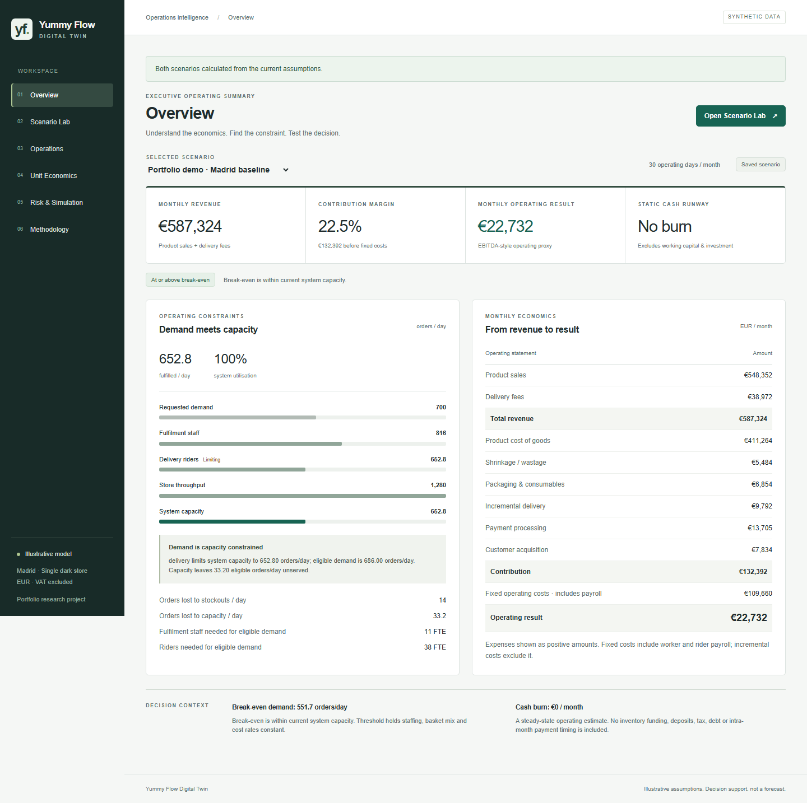
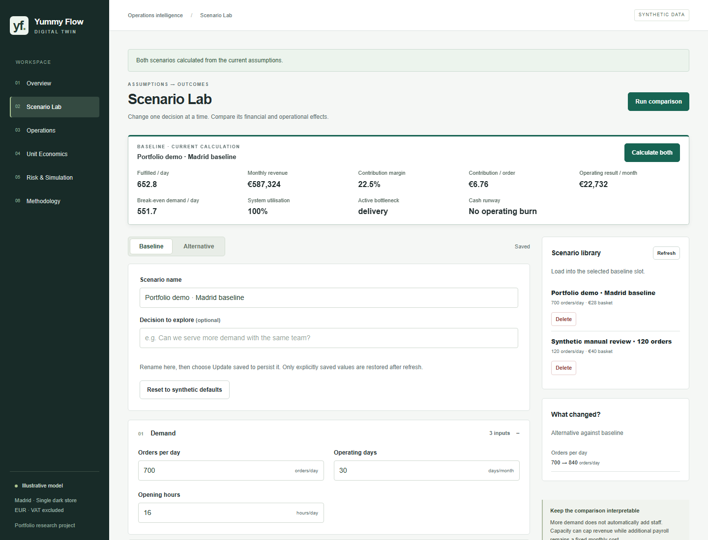
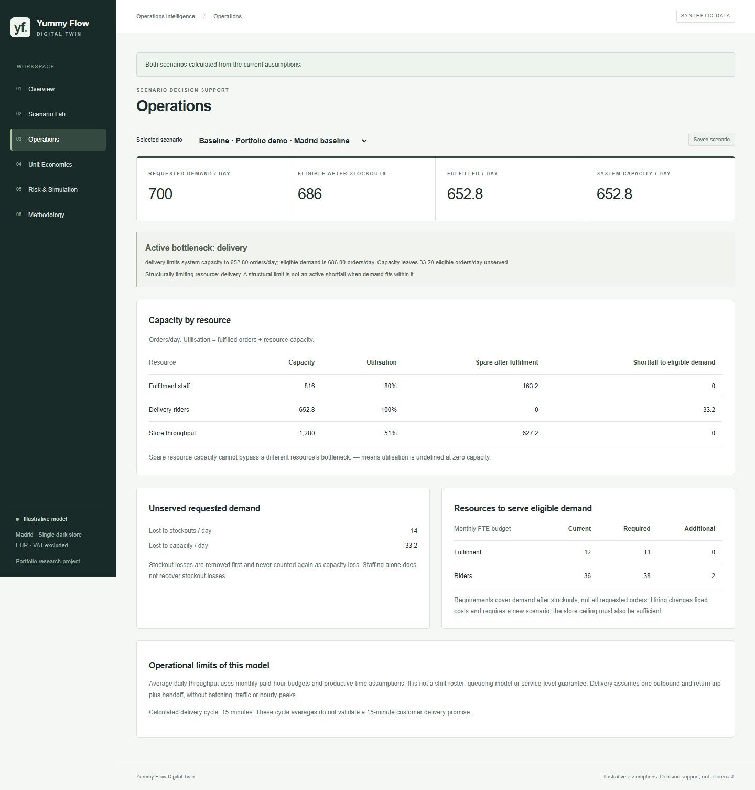
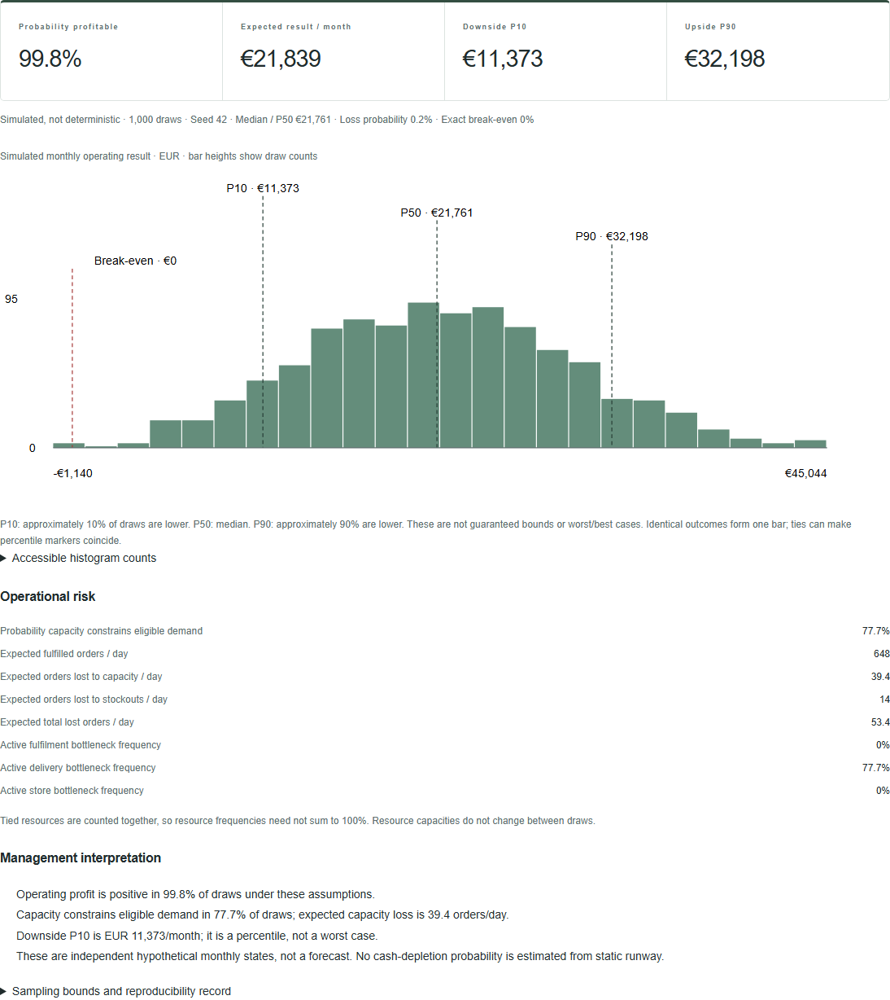
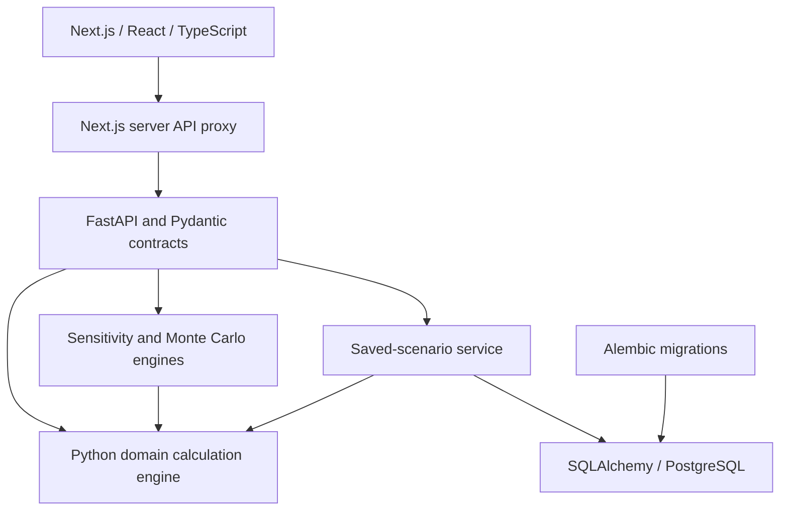

# Yummy Flow Digital Twin

**Quick-Commerce Operations & Unit Economics Simulator**

A decision-support digital twin for analysing the economics, operational capacity and uncertainty of a hypothetical quick-commerce dark store. Compare staffing and demand assumptions, identify bottlenecks, and see whether growth improves operating results or simply increases unserved demand.

This is a **new portfolio project inspired by earlier Yummy Flow business experience**. All inputs and examples are synthetic; this software did not exist during the original venture and does not represent its historical performance.

## The Problem

Demand, basket value, gross margin, staffing, fulfilment and delivery capacity, variable costs, rent and cash are interconnected. More orders cannot generate more sales once delivery capacity is exhausted. Adding riders increases throughput but also increases fixed payroll. A useful decision model must show both effects together.

## The Solution

The workspace connects editable assumptions to a transparent Python calculation engine. Six views cover the executive overview, scenario comparison, operations, unit economics, sensitivity and Monte Carlo analysis, and methodology. Every result can be traced to assumptions and documented formulas.

## Product Screenshots

Actual local application, using the same synthetic Madrid baseline throughout. Monetary displays are rounded; the underlying model retains precision.

**Overview — economics and the binding delivery constraint**



**Scenario Lab — edit assumptions with results in view**



**Operations — capacity, lost demand and resource requirements**



**Risk & Simulation — simulated outcomes, conditional on the chosen inputs**



[Unit Economics screenshot](docs/screenshots/unit-economics.png) · [Capture details and exact demo results](docs/screenshots/README.md)

## Example Management Questions

- How many orders can the current system fulfil, and which resource is limiting it?
- What order volume is required to break even at the current staffing level?
- What happens if requested demand increases by 20%?
- How does gross margin affect operating result?
- Which tested assumption has the greatest effect on profitability?
- What proportion of simulated outcomes are profitable or capacity constrained?

## Key Capabilities

| Capability | Decision supported |
| --- | --- |
| Scenario modelling | Configure two independent sets of validated business assumptions |
| Operational capacity | Separate requested, stockout-lost, fulfilled and capacity-lost demand |
| Unit economics | Trace monthly and per-order revenue, costs, contribution and operating result |
| Break-even analysis | Distinguish the economic threshold from whether capacity can reach it |
| Baseline vs alternative | Compare financial results, utilisation, staffing needs and static runway |
| Sensitivity analysis | Rank six inputs using one-at-a-time ±10% and ±20% changes |
| Monte Carlo simulation | Examine bounded uncertainty, percentiles and conditional outcome frequencies |
| Scenario persistence | Explicitly save, load, replace, rename and delete PostgreSQL snapshots |

## Example Decision Flow

The default synthetic baseline uses 700 requested orders/day, a €28 basket, €1.99 delivery fee, 25% product gross margin and 30 operating days/month. These are the actual backend results shown above:

| Step | Result |
| --- | ---: |
| Requested demand | 700 orders/day |
| Less 2% stockouts | 686 eligible orders/day |
| Capacity: fulfilment / delivery / store | 816 / **652.8** / 1,280 orders/day |
| Fulfilled demand | **652.8 orders/day**, or 19,584/month |
| Product sales + delivery revenue | €587,324.16/month |
| Product COGS + other variable costs | €454,932.4032/month |
| Contribution | €132,391.7568/month; €6.7602/order |
| Fixed costs, including all payroll | €109,660/month |
| Operating result | **€22,731.7568/month** |

Break-even requires about **540.7 fulfilled orders/day**, or **551.7 requested** after allowing for stockouts. The current capacity can reach it. The operating result is positive, so the simplified cash model reports no operating burn; this does not establish liquidity sufficiency.

Raising requested demand to 840/day (+20%) changes revenue by **€0** with the same resources. Delivery already limits sales. Serving the original 686 eligible orders requires 38 rider FTE budgets rather than 36; hiring changes payroll and must be evaluated as a new scenario.

Gross margin has the largest tested sensitivity range. With the documented uncertainty defaults, 1,000 draws and seed 42, the expected operating result is €21,839/month; P10 / P50 / P90 are €11,373 / €21,761 / €32,198. Profit is positive in 99.8% of draws and capacity binds in 77.7%. Those high profit frequencies reflect narrow, synthetic ranges, not evidence of commercial viability. A 20% relative gross-margin reduction instead produces a deterministic monthly loss of approximately €4,686.

## Architecture



Financial and operational calculations live in backend domain modules, independently usable without the UI or database. Analytics repeatedly evaluates that same model. React formats values and renders charts; persistence stores versioned assumptions rather than cached results. See [Architecture](docs/ARCHITECTURE.md).

## Technology Stack

| Area | Used here |
| --- | --- |
| Frontend | Next.js, React, TypeScript, Tailwind CSS; semantic tables and SVG charts |
| Backend | Python 3.12+, FastAPI, Pydantic, SQLAlchemy |
| Database | PostgreSQL 17, psycopg, Alembic; SQLite for isolated tests/fallback |
| Analytics | Python standard-library `random`, `Decimal` and `Fraction` |
| Local development | Docker, Docker Compose, Windows start/stop launchers |
| Testing and quality | pytest, pytest-cov, Playwright, Ruff, ESLint, Prettier, TypeScript |

## Quantitative Methodology

Fulfilled demand is the minimum of stockout-adjusted demand and the three resource capacities. Contribution deducts product COGS and incremental costs; fixed payroll is deducted once, with other fixed expenses, to obtain operating result. Break-even holds staffing and per-order economics constant and is checked against capacity.

Sensitivity changes one input at a time. Monte Carlo samples five independent triangular inputs, runs each through the same capacity-constrained engine, and reports interpolated percentiles and observed outcome frequencies. P10 is a downside percentile, not a worst case. A fixed seed, inputs, settings and software versions make a run reproducible.

[Full formulas and edge cases](docs/METHODOLOGY.md) · [Synthetic assumptions](docs/ASSUMPTIONS.md) · [Independent hand-worked example](docs/WORKED_EXAMPLE.md)

## Model Boundaries

- Single dark store and a steady-state month; fractional orders represent average rates.
- Synthetic inputs, with no real company dataset or empirical calibration.
- Average FTE-hour budgets; no shift roster, detailed queues, routing optimisation or delivery-time guarantee.
- No customer cohorts, replenishment model, seasonality or demand forecast.
- Operating result excludes depreciation, financing and tax. Static runway also omits investment, working capital and payment timing.
- Independent bounded uncertainty excludes correlations and shocks outside the specified ranges. Simulation outcomes are not predictions or guarantees; no dynamic cash-depletion probability is estimated.
- Local single-user workspace. Unsaved drafts and risk runs are not durable; saved scenarios use explicit updates and last-write-wins persistence.

## Running Locally

Requires Python 3.12+, Node.js 22+, pnpm 11.25.0 and Docker Desktop with a reachable engine. From the project root on Windows:

```powershell
python -m venv .venv
.\.venv\Scripts\python.exe -m pip install -c backend/requirements.lock -e './backend[dev,api]'
# On a fresh checkout only; never overwrite an existing .env:
if (-not (Test-Path .env)) { Copy-Item .env.example .env }
```

Set a local-only password in `.env`, keeping its database URLs consistent. Install the frontend dependencies:

```powershell
cd frontend
pnpm install --frozen-lockfile
cd ..
```

Then double-click **START_YUMMY_FLOW.bat**. It starts PostgreSQL, checks migrations, starts both servers and opens http://localhost:3000. Double-click **STOP_YUMMY_FLOW.bat** when finished; saved database data is retained. See [simple instructions](RUNNING_THE_APP.md).

For separate terminals, the equivalent tested commands are:

```powershell
docker compose up -d --wait
./scripts/backend.ps1 -m app.database.migrate
./scripts/backend.ps1 -m uvicorn app.main:app --host 127.0.0.1 --port 8000
# In a second terminal, from frontend/:
pnpm dev
```

The helper loads the ignored root `.env`; direct Python commands require exported environment variables. [Database guide](docs/DATABASE.md) covers migration safety and test databases. [Frontend guide](frontend/README.md) covers the server-only API URL and local build commands.

## Testing

Independent arithmetic fixtures and boundary regressions test economics, break-even and capacity. API and PostgreSQL tests exercise validation, migrations and saved records across process/container restarts. Browser tests exercise scenario isolation, save/reload, cross-page consistency, sensitivity, seed replay and failure recovery.

```powershell
# Project root; PostgreSQL running. Restart test briefly restarts this project's DB.
$env:YUMMY_TEST_COMPOSE_RESTART = '1'
./scripts/backend.ps1 -m pytest --cov=app.domain --cov=app.analytics --cov-branch
./scripts/backend.ps1 -m alembic check
./scripts/backend.ps1 -m ruff check app tests
./scripts/backend.ps1 -m ruff format --check app tests
./scripts/backend.ps1 -m pip check
```

From `frontend/`: `pnpm lint`, `pnpm typecheck`, `pnpm format:check`, `pnpm build`. With the API and frontend running, run `pnpm exec playwright install chromium` once, then `pnpm test`. Run database-restart tests separately from browser tests. Stop the development server before building; `pnpm start` serves the build locally.

[Final validation record](docs/PORTFOLIO_REVIEW.md) records what was actually verified. A skipped PostgreSQL test is not verification. No Python static type checker or automated CI workflow is configured.

## Project Background

The earlier Yummy Flow concept explored rapid grocery and household-goods delivery in Madrid. Work on that concept included dark-store operations, inventory and fulfilment, financial modelling, competitor research and product coordination.

This new software project turns those operational questions into an inspectable decision-support tool. It demonstrates business modelling, quantitative analysis, product workflow design, API/database engineering and testable software boundaries. The analytical contribution is transparent sensitivity and simulation; it does not claim machine learning or generative AI.
